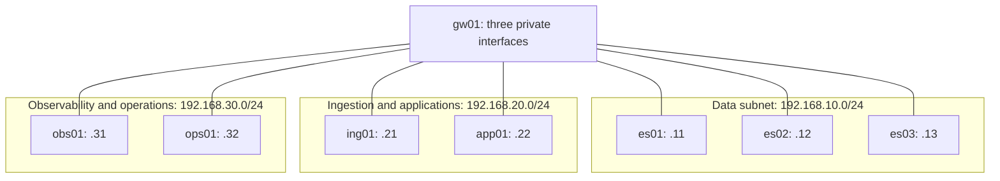
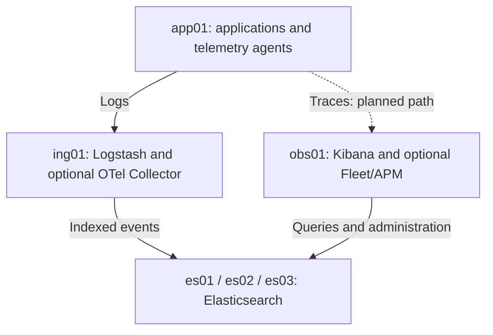

# ELK Observability Lab

A VM-based foundation for building and operating an Elastic observability platform on an ARM64 workstation.

The lab separates Elasticsearch, ingestion, application workloads, and operations across eight Oracle Linux VMs and three private subnets. It is designed for hands-on infrastructure administration, observability pipelines, and controlled incident exercises.

> **Current scope:** the Vagrantfile creates VMs and provisions persistent private IPv4 addresses. Elasticsearch, Logstash, Kibana, Beats, OpenTelemetry, DNS, and gateway routing are planned services, not installed by this file.

## Contents

- [Architecture](#architecture)
- [VM inventory](#vm-inventory)
- [Requirements](#requirements)
- [Quick start](#quick-start)
- [How network provisioning works](#how-network-provisioning-works)
- [Validate the infrastructure](#validate-the-infrastructure)
- [Day-to-day operations](#day-to-day-operations)
- [Troubleshooting](#troubleshooting)
- [Build the observability platform](#build-the-observability-platform)
- [Repository hygiene](#repository-hygiene)
- [References](#references)

## Architecture

### Provisioned network layout



Lines indicate subnet attachment, not configured packet forwarding. Each VM also retains a separate NAT adapter for Vagrant access and outbound connectivity.

| Subnet | Purpose | Address on gw01 |
| --- | --- | --- |
| 192.168.10.0/24 | Elasticsearch data tier | 192.168.10.10 |
| 192.168.20.0/24 | Ingestion and application workloads | 192.168.20.10 |
| 192.168.30.0/24 | Observability interfaces and operations | 192.168.30.10 |

Private networks use VirtualBox's default host-only attachment. They include the host; they are not an enforced security boundary. Recent macOS versions use VirtualBox host-only networks rather than legacy host-only adapters.

**Cross-subnet communication is not configured yet.** gw01 has an address on each subnet, but this file does not enable IP forwarding, install routes on other VMs, or configure forwarding firewall rules.

Each VM currently has its own NAT egress. Traffic is not forced through gw01. The NetworkManager profiles deliberately omit private-interface gateways and DNS servers and set `ipv4.never-default yes`.

### Intended telemetry flow

Once service deployment and routing are implemented:



The traces path is a design placeholder. Decide whether to use an OpenTelemetry Collector, an APM intake service, or both before configuring instrumentation.

## VM inventory

Roles below describe the intended deployment.

| VM | Private IPv4 address | vCPUs | RAM | Intended role |
| --- | --- | ---: | ---: | --- |
| es01 | 192.168.10.11 | 2 | 5 GiB | Elasticsearch node |
| es02 | 192.168.10.12 | 2 | 5 GiB | Elasticsearch node |
| es03 | 192.168.10.13 | 2 | 5 GiB | Elasticsearch node |
| ing01 | 192.168.20.21 | 2 | 4 GiB | Logstash; optional OTel Collector |
| app01 | 192.168.20.22 | 2 | 3 GiB | Sample applications and telemetry generation |
| obs01 | 192.168.30.31 | 2 | 4 GiB | Kibana; optional Fleet/APM |
| ops01 | 192.168.30.32 | 1 | 2 GiB | Administration and automation tooling |
| gw01 | 192.168.10.10, 192.168.20.10, 192.168.30.10 | 1 | 1 GiB | Planned router and DNS server |
| **Total** | **8 VMs** | **14** | **29 GiB** | |

The Vagrantfile expresses RAM in MiB: 5120 MiB is 5 GiB.

On a 48 GiB workstation, these allocations leave 19 GiB before hypervisor and other host overhead. Guest vCPUs are scheduled resources, not dedicated physical cores.

Disk capacity comes from the downloaded box: this file does not resize disks or create dedicated Elasticsearch data volumes. Inspect storage before adding substantial test data.

All VMs run on one host. Three Elasticsearch VMs support node-failure exercises after cluster deployment, but do not provide resilience against host failure.

## Requirements

- An ARM64 host and a compatible VirtualBox installation. The configured `oraclelinux/8-aarch64` box is architecture-specific.
- Vagrant with a working VirtualBox provider.
- Host access to the Oracle box metadata, box downloads, and guest package repositories when installing services.
- Enough free RAM and disk for the selected VMs.
- No conflicting host LAN or VPN routes for the three lab subnets.

The troubleshooting context used Vagrant 2.4.9 and VirtualBox 7.2. This documents the reported environment, not a compatibility test matrix.

Check installed tools:

```bash
vagrant --version
VBoxManage --version
```

### Host-only address restrictions

If VirtualBox rejects the lab ranges, consult its host-only network address restrictions. On affected Linux/macOS installations, merge this allowlist into `/etc/vbox/networks.conf` while preserving existing entries:

```text
* 192.168.10.0/24 192.168.20.0/24 192.168.30.0/24
```

Use the VirtualBox Network Manager to inspect host-only subnet settings. Any DHCP pool must avoid the static lab addresses.

## Quick start

Place the supplied infrastructure file at the root of your repository, named exactly `Vagrantfile`. Run the following commands from that directory.

### 1. Validate configuration

```bash
vagrant validate
```

### 2. Boot one VM first

```bash
vagrant up es01 --provider=virtualbox
vagrant ssh es01 -c 'ip -4 -br address'
```

Verify that a private interface has `192.168.10.11/24`. Interface names vary; the provisioner discovers them by MAC address.

### 3. Start the remaining infrastructure

```bash
vagrant up --provider=virtualbox
vagrant status
```

On first creation, Vagrant runs the shell provisioners automatically. An already-created VM does not necessarily rerun them on every `vagrant up`; use `--provision` explicitly when needed.

### 4. Access a VM

```bash
vagrant ssh es01
vagrant ssh gw01
```

Use Vagrant SSH initially. Private-IP SSH requires appropriate credentials and guest firewall access; the file does not install your personal SSH public key.

The current file also disables the `/vagrant` synced folder. Files in the host repository are not automatically mounted inside the guests.

## How network provisioning works

For each VM and each private IP, the Vagrantfile:

1. Declares a private /24 network with `auto_config: false`, bypassing Vagrant's guest network configurator.
2. Assigns a deterministic MAC address to the private adapter.
3. Explicitly selects `virtio` through both the network declaration and a VirtualBox customization.
4. Runs the shell provisioner as root.
5. Searches `/sys/class/net/*/address` for the expected MAC, retrying up to 15 times.
6. Starts NetworkManager and marks the interface as managed.
7. Creates or updates a profile named `lab-private-N`.
8. Sets the static IPv4 address, enables autoconnect, disables IPv6 on that private profile, and activates it.
9. Removes the malformed `/etc/sysconfig/network-scripts/ifcfg-` file if an earlier failed configuration left it behind.

Adapter 1 remains the box's NAT adapter. Regular VMs use adapter 2 for their private network. gw01 uses adapters 2, 3, and 4.

Example for es01:

| Property | Value |
| --- | --- |
| Private adapter | 2 |
| Adapter type | virtio |
| MAC | 02:00:00:01:01:01 |
| NetworkManager profile | lab-private-1 |
| Address | 192.168.10.11/24 |

Repeated provisioning updates the named profiles rather than intentionally creating duplicates. It may interrupt traffic on the reactivated private interface. It does not remove every pre-existing connection profile.

MAC addresses depend on each VM's position in the `vms` array and each address's position in `ips`. Preserve that ordering for stable MACs. Separate copies of the lab also need distinct VM names and MACs if they share networks.

## Validate the infrastructure

### Inspect addresses and profiles

```bash
vagrant ssh es01 -c 'ip -4 -br address; ip route; nmcli device status'
vagrant ssh es01 -c 'nmcli connection show lab-private-1'
vagrant ssh gw01 -c 'ip -4 -br address'
```

gw01 should have all three private addresses. Its NAT interface remains separate.

The NAT address, commonly `10.0.2.15`, may appear on several VMs because each has its own VirtualBox NAT context.

### Check same-subnet reachability

After es02 and gw01 are running:

```bash
vagrant ssh es01 -c 'ping -c 3 192.168.10.12'
vagrant ssh es01 -c 'ping -c 3 192.168.10.10'
```

ICMP can be blocked by firewall policy. A failed ping requires checking address configuration, link state, and firewall rules; it does not by itself prove the adapter is missing.

### Inspect virtual hardware

Run on the host:

```bash
VBoxManage showvminfo es01 --machinereadable |
  grep -E '^(nic|nictype|macaddress|cableconnected|hostonly)'
```

For adapter 2, confirm an enabled private attachment, `nictype2="virtio"`, `macaddress2="020000010101"`, and a connected cable.

Network names are assigned by VirtualBox/Vagrant and may differ between hosts.

## Day-to-day operations

| Task | Command |
| --- | --- |
| Show VM state | `vagrant status` |
| Start all VMs | `vagrant up` |
| Start one VM | `vagrant up es01` |
| Rerun guest provisioning | `vagrant provision es01` |
| Apply hardware changes and provision | `vagrant reload es01 --provision` |
| Stop one VM | `vagrant halt es01` |
| Stop all VMs | `vagrant halt` |
| Inspect SSH connection settings | `vagrant ssh-config es01` |
| Delete one VM and its VM-local data | `vagrant destroy es01` |

Use a full stop/start for adapter changes if a reload does not apply them:

```bash
vagrant halt es01
vagrant up es01 --provision
```

Once Elasticsearch is installed, stop nodes deliberately and monitor cluster health. Do not destroy data nodes unless their data is disposable or recoverable.

## Troubleshooting

### Vagrant calls ifup/ifdown with an empty interface name

Example:

```text
/sbin/ifdown ''
/etc/sysconfig/network-scripts/ifcfg-
/sbin/ifup ''
```

This indicates a failure in Vagrant's legacy guest network configuration, including an unresolved device name. The current file bypasses that path with `auto_config: false` and configures NetworkManager directly.

Check that every private network declaration retains `auto_config: false`.

### Private adapter with MAC … is missing

The provisioner cannot find the expected adapter in the guest. Installing network scripts cannot create a missing interface.

1. Inspect VirtualBox hardware with the command above.
2. Confirm adapter type, cable state, attachment, and expected MAC.
3. Confirm the per-adapter customization includes `--nictypeN virtio`.
4. Halt the VM and start it again with `--provision`.
5. If the hardware is correct, inspect guest kernel logs:

```bash
vagrant ssh es01 -c 'ip -br link'
vagrant ssh es01 -c 'sudo journalctl -k -b --no-pager'
```

A previously observed configuration exposed the NAT adapter as virtio but left the private adapter as `82540EM`. The explicit customization prevents relying solely on the network declaration for the adapter type.

### Adapter exists but no private IP is assigned

```bash
vagrant provision es01
vagrant ssh es01 -c 'nmcli device status; nmcli connection show'
vagrant ssh es01 -c 'sudo journalctl -u NetworkManager -b --no-pager'
```

Check for competing autoconnect profiles bound to the same private interface. Inspect them before removing anything; preserve the NAT connection used for access.

### Same-subnet works, but another subnet is unreachable

This is expected until routing is implemented. Verify both forward and return routes, gw01 IP forwarding, and forwarding firewall rules when adding that feature. Do not disable the firewall globally to work around missing routing.

### SSH works, but host-to-private-IP access does not

Vagrant SSH normally uses NAT port forwarding. Successful SSH does not validate host-only routing. Check the host-only network, host/VPN routes, and guest firewall.

### Host memory pressure or slow provisioning

Stop unused VMs or provision subsets. The full lab allocates 29 GiB of guest RAM, plus virtualization overhead. These are starting lab allocations, not measured service capacity.

## Build the observability platform

The following work remains after infrastructure provisioning:

| Phase | Work | Completion evidence |
| --- | --- | --- |
| 1. Network foundation | Configure DNS, inter-subnet routes, gw01 forwarding, and scoped firewall rules | Name resolution and approved cross-subnet traffic work in both directions |
| 2. OS baseline | Configure time synchronization, storage, service accounts, and version-specific OS prerequisites | Consistent configuration and adequate free storage on every node |
| 3. Elasticsearch | Select and pin an ARM64-compatible version; configure three nodes, TLS, authentication, discovery, and data paths | Cluster membership verified and test data indexed |
| 4. Kibana | Install a compatible version on obs01 and configure authenticated TLS access to Elasticsearch | Kibana opens and queries test data |
| 5. Logs pipeline | Install Logstash on ing01 and agents on app01; configure parsing and delivery | A generated application event is searchable |
| 6. Metrics and traces | Select agent/Collector/APM deployment and supported versions | Host metrics and an application trace are visible |
| 7. Operations | Add dashboards, alerting, lifecycle policies, snapshots, and runbooks | Alert delivery and a snapshot restore are demonstrated |
| 8. Incident exercises | Introduce controlled node, network, ingestion, and application failures | Symptoms, diagnosis, remediation, and recovery evidence are recorded |

Choose service versions against the Elastic support and compatibility matrices before installation. The Vagrantfile does not select an Elastic version.

Before treating gw01 as the routed path, add specific remote-subnet routes to each VM and explicit forwarding policies on gw01. Keeping the current NAT default route preserves Vagrant access and outbound package downloads.

For stricter routing exercises, evaluate internal networks or host forwarding controls: host-only networks attach the host to each subnet, so gw01 is not automatically the only possible path.

Security and resilience belong in the service deployment:

- Use TLS and scoped credentials for service communication.
- Keep secrets and private keys out of Git.
- Plan Elasticsearch disk capacity, heap settings, replica placement, and snapshot storage.
- Account for single ingestion, UI, and gateway VMs as potential failure points.
- Test recovery rather than inferring availability from VM count.

## Repository hygiene

At minimum, keep the supplied `Vagrantfile` and this `README.md` at the repository root. Add service automation and runbooks as they are implemented.

Suggested additions, not files supplied by this documentation:

| Path | Purpose |
| --- | --- |
| scripts/ | Reusable provisioning and validation scripts |
| ansible/ | OS and service configuration |
| docs/architecture.md | Service design and routing decisions |
| docs/runbooks/ | Incident and recovery procedures |
| docs/scenarios/ | Reproducible fault exercises |

Suggested `.gitignore` entries:

```gitignore
.vagrant/
.env
.env.*
!.env.example
*.box
*.log
secrets/
*.key
*.pem
```

Review ignored certificate patterns if the repository intentionally tracks public certificates. Commit only sanitized examples.

No license is implied by this README. Add a LICENSE file after choosing how the project may be reused.

## References

- [Vagrant private networks and auto_config](https://developer.hashicorp.com/vagrant/docs/networking/private_network)
- [Vagrant VirtualBox networking and NIC types](https://developer.hashicorp.com/vagrant/docs/providers/virtualbox/networking)
- [Vagrant VirtualBox customizations](https://developer.hashicorp.com/vagrant/docs/providers/virtualbox/configuration)
- [Oracle Linux 8: NetworkManager and nmcli](https://docs.oracle.com/en/learn/nmcli_ip_linux8/index.html)
- [VirtualBox 7.2 networking and host-only restrictions](https://docs.oracle.com/en/virtualization/virtualbox/7.2/user/networkingdetails.html)
- [Elastic support matrix](https://www.elastic.co/support/matrix)
